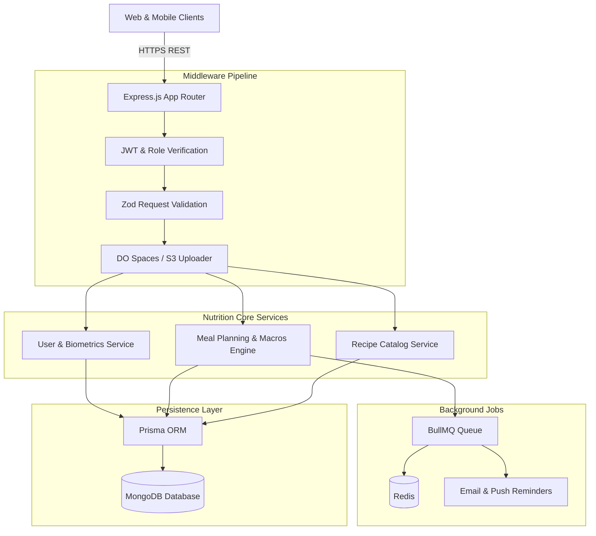

# Sanaz Shahin Backend - Personalized Nutrition & Meal Planning API

<p align="center">
  
</p>

<p align="center">
  <a href="https://nodejs.org"></a>
  <a href="https://expressjs.com"></a>
  <a href="https://www.typescriptlang.org"></a>
  <a href="https://www.prisma.io"></a>
  <a href="https://www.mongodb.com"></a>
  <a href="https://bullmq.io"></a>
  <a href="LICENSE"></a>
</p>

---

## 📖 Overview

**Sanaz Shahin Backend (`sanazshahin_backend`)** is an intelligent nutrition, dietary health, and meal planning RESTful API service built with Express.js, TypeScript, and Prisma ORM with MongoDB. The API enables users to track biometric fitness metrics (target weight, caloric requirements, dietary restrictions), generate personalized daily meal plans, compute nutritional macronutrients (protein, fat, fiber, carbs, kcal), schedule BullMQ reminder queues, and manage cloud culinary media.

---

## ⚡ Key Features

- **🥗 Nutrition & Biometrics Modeling:** Comprehensive user health profiles capturing height, weight, dietary restrictions, fitness targets, and daily meal plans.
- **🍳 Recipe Database & Scraper:** Rich recipe schema tracking preparation time, equipment required, caloric density, macro breakdowns, and YouTube video guides.
- **📊 Macro & Caloric Calculator:** Automated daily aggregation of essential macronutrients (fiber, fat, carb, iron, protein, kcal) for assigned meal plans.
- **⚡ BullMQ Background Jobs & Redis:** Asynchronous reminder scheduling (meal reminders, grocery alerts, weekly health summaries) and Bull-Board monitoring.
- **☁️ DigitalOcean Spaces Asset Integration:** AWS SDK v3 file upload handling for culinary imagery and video attachments.

---

## 🏗️ System Architecture



---

## 🗂️ Project Structure

```
sanazshahin_backend/
├── assets/
│   └── banner.svg               # Architectural repository banner
├── prisma/
│   └── schema.prisma            # MongoDB schema definitions
├── src/
│   ├── app/
│   │   ├── modules/             # Auth, User, Recipe, MealPlan, Bookmark
│   │   ├── middlewares/         # Auth, validation, error handler
│   │   └── routes/              # Centralized route aggregator
│   ├── config/                  # Environment variables & DB connectors
│   ├── helpers/                 # DO Spaces, JWT, encryption
│   ├── services/                # BullMQ background workers
│   ├── app.ts                   # Express server definition
│   └── server.ts                # Application bootstrapper
├── package.json
└── tsconfig.json
```

---

## 🛠️ Tech Stack

| Technology | Purpose |
| :--- | :--- |
| **Node.js & Express 4** | Backend HTTP API runtime |
| **TypeScript 5** | Strict type definitions and interfaces |
| **Prisma ORM 6** | MongoDB object-relational mapping |
| **MongoDB** | Document datastore for health metrics, recipes, and meal plans |
| **BullMQ & Redis** | Distributed background task queue and notifications |
| **AWS SDK v3 / Spaces** | Cloud object storage for recipe media |
| **Zod** | Runtime request payload validation |

---

## 🚀 Getting Started

### Prerequisites

- Node.js >= 20.0.0
- MongoDB instance (MongoDB 6+)
- Redis instance
- npm or yarn

### Installation

1. Clone the repository:
   ```bash
   git clone https://github.com/shahjalal-labs/sanazshahin_backend.git
   cd sanazshahin_backend
   ```

2. Install dependencies:
   ```bash
   npm install
   ```

3. Configure environment variables:
   ```bash
   cp .env.example .env
   ```

4. Generate Prisma Client:
   ```bash
   npx prisma generate
   ```

5. Run development server:
   ```bash
   npm run dev
   ```

---

## 📄 License

This project is licensed under the [ISC License](LICENSE).
